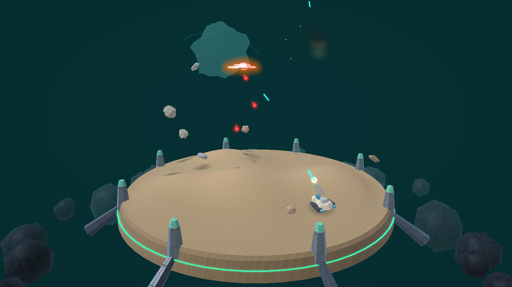

# Domeblast 3D

An original, fully three-dimensional arena shooter inspired by old 1980s
games. Defend a circular, dune-covered arena from meteors, spinners, guided
missiles and UFOs across six sectors, scored by **Six Skies**, an original
six-piece soundtrack composed for this project.



## Platforms

| Platform | Build | Install |
|---|---|---|
| Anbernic RG DS (ROCKNIX), Anbernic RG34XXSP (muOS) | `Domeblast3D-Handhelds.zip` | ROCKNIX: extract into `/roms/ports/`. muOS: put `domeblast3d/` under the SD card's `ports/` and `Domeblast 3D.sh` under `ROMS/Ports/`. Or run `./tools/device/install.sh <device-ip>`. |
| AYN Odin 3 (ArmadaOS / Steam) | `Domeblast3D-Odin3-ArmadaOS.zip` | See [port/armada/README.md](port/armada/README.md). |
| Web browsers, phones, Meta Quest (WebXR) | `domeblast-web-upload.zip` | Upload the contents to any HTTPS static host; serve `.wasm` as `application/wasm`. |

## Build

```sh
# Native ARM64 executable, cross-built in Docker from any host
./tools/build/build.sh

# Or directly on ARM64 Linux with g++, make, pkg-config, libsdl2-dev and libgles2-mesa-dev
make

# Packages -> build/*.zip
./tools/package/package.sh            # RG DS / RG34XXSP
./tools/package/package-armada.sh     # Odin 3

# Web (requires Emscripten 6.0.9; set EMSDK or activate emsdk_env.sh first)
npm run build                         # -> dist/
npm run package:web                   # -> build/domeblast-web-upload.zip
```

## License

Domeblast 3D is open source. You are welcome to use, modify and share it,
including commercially, as long as you give credit.

- Source code, shaders and scripts: [MIT License](LICENSE)
- Original artwork, textures and music: [CC BY 4.0](LICENSE-ASSETS)

Credit the project as:

> Domeblast 3D by omerkot — https://github.com/omerkot/Domeblast3D

All code, models, artwork, music and sound effects were created for this
project. Bundled third-party components keep their own licenses:

| Component | License |
|---|---|
| Liberation Mono (in-game font, `assets/font.bmp`) | SIL Open Font License, `assets/FONT-LICENSE.txt` |
| stb_vorbis and stb_image by Sean Barrett (`third_party/`) | Public domain or MIT |

## Disclaimer

Domeblast 3D is an independent project. It is not affiliated with, sponsored
by, endorsed by or otherwise connected to any company, organization, person,
game or product. All trademarks belong to their respective owners. Hardware,
operating-system, store and browser names, such as Anbernic, ROCKNIX, muOS,
AYN Odin, ArmadaOS, Steam and Meta Quest, are used only to identify compatible
platforms.
